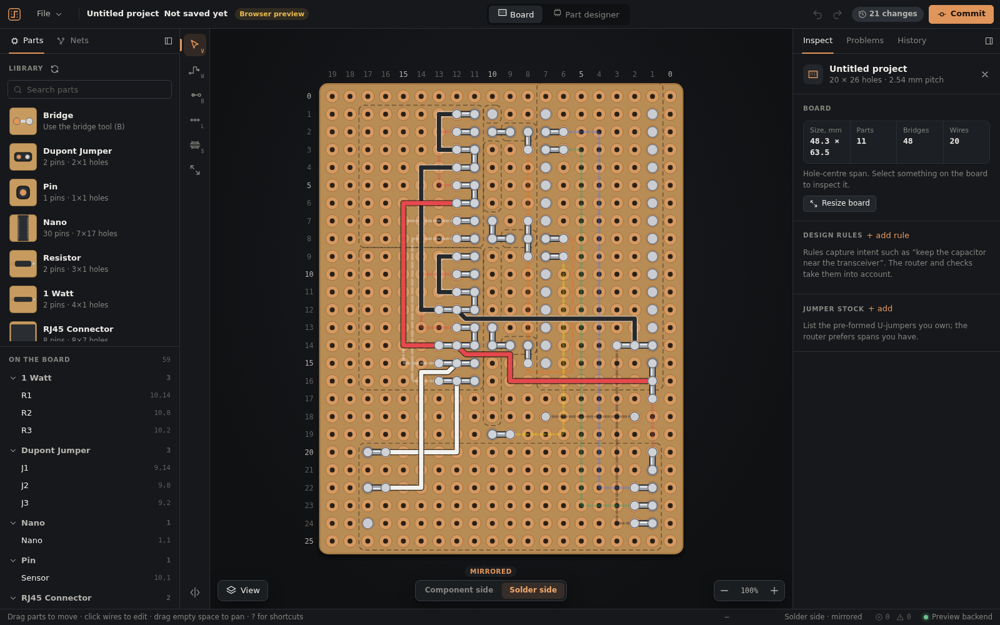

# Perfboard Designer

[](https://openai.com/codex/)
[](https://claude.com/claude-code)

Perfboard Designer is a local-first desktop application for designing small
circuits on isolated-pad perfboard. The project is under active development.
Milestone 5 provides the graphical editor, revisioned transactions,
deterministic automatic routing, and local MCP access to the active desktop
working copy from Codex or Claude Code.



## Prerequisites

- Rust 1.90 or newer
- Node.js 22 or newer and npm
- The [Tauri 2 system dependencies](https://v2.tauri.app/start/prerequisites/)
  for your operating system
- The Tauri CLI (`cargo install tauri-cli --version '^2' --locked`)

## Setup and development

```sh
npm --prefix frontend ci
cargo tauri dev
```

The Tauri command starts Vite automatically. For browser-only frontend work,
run `npm --prefix frontend run dev`: without Tauri the UI uses an in-memory
preview backend loaded with the example design, marked **Browser preview**.
See [the frontend developer notes](docs/ui/DEVELOPER_NOTES.md).

To install the locked frontend dependencies and build an optimized desktop
executable in one step:

```sh
./quickstart.sh
```

## Quality checks

```sh
cargo fmt --all --check
cargo clippy --workspace --all-targets -- -D warnings
cargo test --workspace
npm --prefix frontend run format:check
npm --prefix frontend run lint
npm --prefix frontend test
npm --prefix frontend run build
```

The authoritative product scope is in [the blueprint](docs/BLUEPRINT.md), and
the milestone sequence is in [the development plan](docs/plan/DEVELOPMENT_PLAN.md).

## Versioning

Versions follow `v{major}.{minor}.{patch}`, where the parity of the minor
number tells you what kind of build you have:

| Line | Example | Patch number |
| --- | --- | --- |
| Odd minor: development | `v0.1.26` | Commit count of `HEAD`, automatic |
| Even minor: release | `v0.2.0`, `v0.2.1` | Set by hand, only for releases |

The declared line lives in `[workspace.package] version` in `Cargo.toml`
(`0.1.0` on a development line, whose patch must stay `0`). Print the
effective version with:

```sh
cargo run -q -p perfboard-version
```

The running app shows it at the bottom of the File menu, and the MCP server
reports it to clients and with `perfboard-mcp-server --version`. Builds of a
development line need Git history; from a source archive, set
`PERFBOARD_COMMIT_COUNT`. See [ADR 0010](docs/adr/0010-versioning.md).

### Releasing

1. Set the release version (even minor) in `Cargo.toml` and
   `frontend/package.json`, for example `0.2.0`, and move the
   `Unreleased` notes in [CHANGELOG.md](CHANGELOG.md) under it. Commit.
2. Tag and push: `git tag v0.2.0 && git push origin main v0.2.0`. The release
   workflow checks the tag, builds Linux `.deb` and AppImage bundles, and
   opens a draft GitHub release to review and publish.
3. Set the next development line, `0.3.0`, in both files and commit.

Fix releases (`v0.2.1`) are cut the same way from a branch at `v0.2.0`.

## Editor

The window has a parts and nets panel on the left, a tool rail, the board, and
an inspector on the right with Problems and History tabs. Press `?` for all
keyboard shortcuts.

- **Place parts** by choosing one in the library and clicking a hole; `R`
  rotates. Drag parts to move them, or nudge with the arrow keys.
- **Connect** with the wire tool (`W`): click a pin, click holes to bend, click
  the target pin. Starting from a pin with no net asks for a net name. Dashed
  lines show connections that are still unrouted; click one to get a suggested
  route, then accept or discard it. Bridges (`B`) and rails (`L`) have their own
  tools.
- **Component side / Solder side** switches the face. The solder side is
  mirrored, as seen when the board is flipped; only the presentation is
  mirrored and stored coordinates stay canonical.
- **Problems** lists validation findings with advice; clicking one frames the
  object. Manual edits may temporarily leave a part out of bounds or
  overlapping; the edit is kept and reported until resolved.
- **History** shows each step with its origin. Agent steps are marked in violet
  with the agent's rationale. Commit to create a named checkpoint, compare the
  working copy with any commit (highlighted or side by side), or restore one.
- **File → Print build drawing** prints both faces and a wire cut list.

Electrical changes proposed by an agent appear under **Needs your approval** in
the Nets panel and stay inactive until accepted.

The app starts on an empty board, ready for your own project; **File → New
board…** sets another size in holes. A small sample with two parts and four
wires is at `examples/nano-rs485.perfboard.json`.

## Component Designer

Switch to Part designer to open an existing component directory or start
a draft in an empty directory. Metadata, body geometry, rotations, pins,
occupied holes, keepouts, access regions, and Markdown documentation are edited
as a separate Rust-validated draft with undo and redo. Pins can be moved on the
preview and always snap to the integer 2.54 mm grid; the form provides the same
operation without a pointer.

Saving is explicit and is disabled while the draft is invalid. A save fails if
`component.toml` or `README.md` changed externally since the draft was opened.
Successful replacement retains the immediately previous files as
`component.toml.bak` and `README.md.bak` in the component directory. To recover,
close the component, inspect the backup, and copy the wanted backup over its
corresponding live file before reopening. Saved project component snapshots are
not modified by Component Designer saves.

## MCP access from Codex and Claude Code

Start the desktop app first with `cargo tauri dev`. The repository includes a
trusted-project Codex configuration in `.codex/config.toml` and a Claude Code
project configuration in `.mcp.json`. On first use, review and trust the project
configuration. Both clients start the stdio adapter with Cargo; the adapter then
discovers and authenticates to the active desktop session.

From the repository root, verify the Codex registration with:

```sh
codex mcp list
```

Claude Code reads `.mcp.json` automatically. Verify it with:

```sh
claude mcp get perfboard-designer
```

The first adapter startup can take longer while Cargo compiles dependencies.
For a faster reusable executable, run
`cargo build --release -p perfboard-mcp-server`, then replace the configuration
command with the absolute path to `target/release/perfboard-mcp-server`.
Restart Codex after changing `.codex/config.toml`; the checked-in configuration
forwards the per-user runtime directory used by the desktop session host.

Every write tool requires the revision returned by a fresh read. Codex is
configured to approve writes while allowing annotated read tools normally;
Claude Code applies its own MCP permission policy. If more than one desktop
session is running, set `PERFBOARD_DESIGNER_SESSION_ID` in the MCP server's
environment to the session named by the ambiguity error.

The UI listens for session change events and also checks the authoritative
revision while visible, so successful MCP writes should appear without a page
reload. A `session.unreachable` error means a descriptor was found but the MCP
process cannot access its authenticated loopback endpoint; unlike
`app.not_running`, it does not mean that no desktop session was discovered.

The bridge binds only to IPv4 loopback and authenticates every request with an
ephemeral per-launch token stored in the user's runtime directory. It exposes no
arbitrary file or shell tools. Component Markdown returned through MCP is
untrusted reference material, not instructions. See
[ADR 0007](docs/adr/0007-local-mcp-session-bridge.md) for the full lifecycle and
threat boundary.

## Current limitations

Assembly planning begins in Milestone 6, and component-library authoring remains
read-only through MCP until MCP authoring parity is implemented.
Passing validation means that project geometry and basic connectivity are
internally consistent; it is never a guarantee of electrical correctness or
safety.

## Contributing

See [CONTRIBUTING.md](CONTRIBUTING.md).

## License

[MIT](LICENSE)
