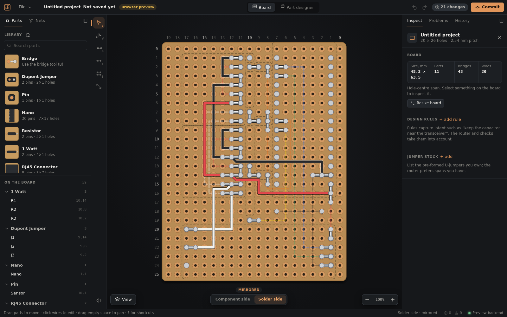
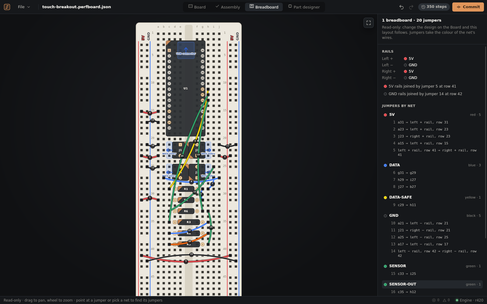

# Perfboard Designer

[](https://github.com/arturormk/perfboard-designer-rust/actions/workflows/ci.yml)
[](https://openai.com/codex/)
[](https://claude.com/claude-code)

Perfboard Designer is a local-first desktop application for designing small
circuits on isolated-pad perfboard. The project is under active development.
Milestone 5 provides the graphical editor, revisioned transactions,
deterministic automatic routing, and local MCP access to the active desktop
working copy from Codex or Claude Code. Milestone 6 (assembly planning) adds
a step-by-step build order with an Assembly mode in the editor, a printable
build drawing with the wire list and a build-order checklist, and 1:1 wire cut
guides and bending templates. A Breadboard tab lays the same design out on
solderless breadboards, so the circuit can be tried before anything is
soldered.



## Prerequisites

- Rust 1.90 or newer
- Node.js 22 or newer and npm
- The [Tauri 2 system dependencies](https://v2.tauri.app/start/prerequisites/)
  for your operating system
- The Tauri CLI (`cargo install tauri-cli --version '^2' --locked`)

## Setup and development

```sh
npm --prefix frontend ci
cargo tauri dev
```

The Tauri command starts Vite automatically. For browser-only frontend work,
run `npm --prefix frontend run dev`: without Tauri the UI uses an in-memory
preview backend loaded with the example design, marked **Browser preview**.
See [the frontend developer notes](docs/ui/DEVELOPER_NOTES.md).

To install the locked frontend dependencies and build an optimized desktop
executable in one step:

```sh
./quickstart.sh          # asks; defaults to the executable
./quickstart.sh exe      # target/release/perfboard-designer and perfboard-mcp-server
./quickstart.sh deb      # or rpm, appimage, or a mix such as deb,rpm (Linux only)
```

The standard component library in `components/` is compiled into the
executable ([ADR 0014](docs/adr/0014-component-library-layers.md)), so the
executable can be copied anywhere. Debug builds (`cargo tauri dev`) read
`components/` from the checkout instead, so edits to it show without
rebuilding, and `PERFBOARD_STANDARD_COMPONENTS=/path/to/components` replaces
the library with another folder in any build. `.deb` and `.rpm` install
`/usr/bin/perfboard-designer` and the MCP adapter as
`/usr/bin/perfboard-mcp-server`. The AppImage keeps the MCP adapter inside the
image, so use a package or the executable build for MCP access. Bundle-only
settings live in `src-tauri/tauri.bundle.conf.json`.

## Quality checks

```sh
cargo fmt --all --check
cargo clippy --workspace --all-targets -- -D warnings
cargo test --workspace
npm --prefix frontend run format:check
npm --prefix frontend run lint
npm --prefix frontend test
npm --prefix frontend run build
```

The authoritative product scope is in [the blueprint](docs/BLUEPRINT.md), and
the milestone sequence is in [the development plan](docs/plan/DEVELOPMENT_PLAN.md).

## Versioning

Versions follow `v{major}.{minor}.{patch}`, where the parity of the minor
number tells you what kind of build you have:

| Line | Example | Patch number |
| --- | --- | --- |
| Odd minor: development | `v0.1.26` | Commit count of `HEAD`, automatic |
| Even minor: release | `v0.2.0`, `v0.2.1` | Set by hand, only for releases |

The declared line lives in `[workspace.package] version` in `Cargo.toml`
(`0.1.0` on a development line, whose patch must stay `0`). Print the
effective version with:

```sh
cargo run -q -p perfboard-version
```

The running app shows it at the bottom of the File menu, and the MCP server
reports it to clients and with `perfboard-mcp-server --version`. Builds of a
development line need Git history; from a source archive, set
`PERFBOARD_COMMIT_COUNT`. See [ADR 0010](docs/adr/0010-versioning.md).

### Releasing

1. Set the release version (even minor) in `Cargo.toml` and
   `frontend/package.json`, for example `0.2.0`, and move the
   `Unreleased` notes in [CHANGELOG.md](CHANGELOG.md) under it. Commit.
2. Tag and push: `git tag v0.2.0 && git push origin main v0.2.0`. The release
   workflow checks the tag, builds Linux `.deb` and AppImage bundles with
   `./quickstart.sh deb,appimage`, and
   opens a draft GitHub release to review and publish.
3. Set the next development line, `0.3.0`, in both files and commit.

Fix releases (`v0.2.1`) are cut the same way from a branch at `v0.2.0`.

## Editor

The top bar switches between the Board, Assembly, Breadboard and Part designer
workspaces. On the Board, the window has a panel on the left with Parts, Nets
and History tabs, a tool rail, the board, and a panel on the right with
Inspect, Problems and Notes tabs. Press `?` for all keyboard shortcuts.

- **Place parts** by choosing one in the library and clicking a hole; `R`
  rotates. Drag parts to move them, or nudge with the arrow keys.
- **Connect** with the wire tool (`W`): click a pin, click holes to bend, click
  the target pin. Starting from a pin with no net asks for a net name. Dashed
  lines show connections that are still unrouted; click one to get a suggested
  route, then accept or discard it, or press `1` to `5` to preview alternatives
  (a different path, fewest bends, shortest, the other side). Each click while
  drawing adds one straight segment, at any angle. Bridges (`B`) and rails
  (`L`) have their own tools. A bridge placed on the solder side is a bare
  link; one placed on the component side (drawn as a thin gray lead) means
  "bend a part's lead across these holes" and is made in that part's
  assembly step. The inspector moves a bridge between the two.
- **Values**: give a part its value in the inspector's Value field.
  Resistors take `4k7`, `4.7k`, `4700` or `4R7` and show `4.7 kΩ`;
  capacitors take `100n`, `0.1u`, `22p` or the code `104` and show `100 nF`;
  other parts take free text such as `1N4148`. A value that cannot be read
  is refused with a hint. A selected resistor's colour code (five bands, 1%
  tolerance) is drawn under its value, each band named. **View → Part
  values** shows values under the part names on the board (off by default);
  the hover card always shows them. The Breadboard tab draws resistors with
  their bands, and Assembly the one being fitted. See [ADR 0019](docs/adr/0019-component-values.md).
- **Select** a part hidden under another, such as a resistor under a module, by
  clicking the same spot again: each click selects the next object down.
- **Tie wires down** with the saddle tool (`S`): click a free hole on each side
  of a wire or bundle. A saddle is a short strap, typically black wire,
  soldered into both holes; it belongs to no net, so its holes must stay clear
  of pins, wires, rails and junctions, and the router avoids them.
- **Component side / Solder side** switches the face. The solder side is
  shown from below, as when the board is turned over. Press `M` (or click the
  tag under the switch) to mirror it instead: every hole stays where it is on
  the component side, so a part or wire is at the same spot on both faces, and
  all labels read backwards so the mirror view is never mistaken for the real
  underside. Only the presentation changes; stored coordinates stay
  canonical.
- **Problems** lists validation findings with advice; clicking one frames the
  object. Manual edits may temporarily leave a part out of bounds or
  overlapping; the edit is kept and reported until resolved. An edit is refused
  only if it adds a design-rule error that was not there before, so a board
  that breaks a rule can be repaired step by step.
- **Batch edit** (top bar) pauses rule checks while you rework the board in
  several steps; turning it off lists what is left in Problems. It is per
  session and off at start, and agents cannot use it. See
  [ADR 0017](docs/adr/0017-rule-checks-and-batch-edit.md).
- **Notes** holds review notes that an agent leaves in the project, in severity
  order until you reorder them. Acknowledge a note, or reply and request a
  review; the tab copies a ready-made request for the agent's chat, and the
  agent's answer appears under your reply. **Keep as issue** moves a note to
  the tab's Issues list, which survives later reviews: agents read issues but
  cannot change or remove them. Notes and issues are saved with the project
  but are not undo steps or part of commits. See
  [ADR 0015](docs/adr/0015-review-notes.md),
  [ADR 0016](docs/adr/0016-review-note-replies.md) and
  [ADR 0020](docs/adr/0020-issues.md).
- **History** shows each step with its origin. Agent steps are marked in violet
  with the agent's rationale. Commit to create a named checkpoint, compare the
  working copy with any commit (highlighted or side by side), or restore one.
- **Assembly** (tab) builds the board one step at a time, from a plan derived
  from the design: one step per part, wire, rail, bridge and saddle, in an
  order that respects physical dependencies, followed by continuity and
  short checks. The board shows what is installed so far, with the current
  step's holes ringed, on the face it is done on. Beside it are the step's
  instructions, the steps it comes after and why, and for wires and rails
  the colour, net, approximate cut length and bends. **Done, next** (Enter)
  ticks the step; ← and → move between steps. Clicking a check measurement
  rings its test points on the board. Part steps name the value and, for
  resistors, show the colour code to look for beside the instructions, and
  the resistor being fitted is drawn beige with its bands; **parts to gather** above the
  steps groups the parts by type and value, and a note names any resistor or
  capacitor still without a value. Checkmarks are kept in the app's
  configuration folder, not in the project; when the design changes, a
  banner says which steps were added, changed or removed, and a ticked step
  that changed is flagged. See
  [ADR 0012](docs/adr/0012-assembly-planning.md).
- **File → Print build drawing** prints both faces, the parts grouped by
  value, the wire list in build order with estimated cut lengths, and a
  build-order checklist with a box for every step and continuity measurement.
  It is a reference drawing, not true to scale.
- **File → Export wire templates…** saves a PDF to build the wiring from, then
  opens it in your PDF viewer. A cut guide comes first: every wire laid out
  straight at 1:1 over a millimetre grid, with cut lines, strip marks, and a
  triangle with the angle at every bend, so a wire can be marked while it is
  still straight off the spool. Bending templates follow: every wire shape at
  1:1 over the board's hole grid, dimensioned in millimetres and hole pitches
  and grouped by insulation colour. Pages are A4, or US Letter where that is
  the local paper size.

  **Print the PDF at actual size**: in the print dialog, set *Page Scaling* to
  *None* (in some viewers, *Actual size* or 100 %). "Fit" or "Shrink to
  printable area" changes every length. Then check that the 50 mm bar at the
  top of each page measures 50 mm. The templates are a PDF because the app's
  web view cannot print at an exact scale; see
  [ADR 0011](docs/adr/0011-true-scale-pdf-output.md).
- **Breadboard** (tab) rebuilds the design on standard full-size solderless
  breadboards, to try the circuit on the bench first. Parts straddle the
  channel or sit on one side with a row per pin; ground and supply take the
  rails; every connection is a numbered Dupont jumper in the colour of the
  net's wires, listed by net in the panel. More boards are added side by side
  when one is not tall enough, and parts that cannot sit on a board, such as
  2×N headers, go beside it with male–female leads. Access areas such as a
  Nano's USB end are kept clear. Resistors are drawn beige with their bands;
  hovering one shows its colour code, and **Resistor colour codes** in the
  panel lists every resistor's bands as a reference. The view is read-only, follows every
  design change, and checks its own connectivity against the nets; see
  [ADR 0018](docs/adr/0018-breadboard-layout.md).

  

Electrical changes proposed by an agent appear under **Needs your approval** in
the Nets panel and stay inactive until accepted.

The app starts on an empty board, ready for your own project; **File → New
board…** sets another size in holes. A small sample with two parts and four
wires is at `examples/nano-rs485.perfboard.json`.

## Component Designer

Switch to Part designer to see the open project's parts, library by library:
its own folder (`board.perfboard/` beside `board.perfboard.json`), a user
library you grant it, and the built-in standard library. Open a part to edit
it, start a new one, copy a standard part to change it, or open any part
folder. [Component libraries](docs/component-libraries.md) explains where
parts live, user-library grants and how to choose identifiers. Metadata, body geometry, rotations, pins,
occupied holes, keepouts, access regions, and Markdown documentation are edited
as a separate Rust-validated draft with undo and redo. Pins can be moved on the
preview and always snap to the integer 2.54 mm grid; the form provides the same
operation without a pointer.

Saving is explicit and is disabled while the draft is invalid. A save fails if
`component.toml` or `README.md` changed externally since the draft was opened.
Successful replacement retains the immediately previous files as
`component.toml.bak` and `README.md.bak` in the component directory. To recover,
close the component, inspect the backup, and copy the wanted backup over its
corresponding live file before reopening. Saved project component snapshots are
not modified by Component Designer saves.

## MCP access from Codex and Claude Code

Start the desktop app first with `cargo tauri dev`. The repository includes a
trusted-project Codex configuration in `.codex/config.toml` and a Claude Code
project configuration in `.mcp.json`. On first use, review and trust the project
configuration. Both clients start the stdio adapter with Cargo; the adapter then
discovers and authenticates to the active desktop session.

From the repository root, verify the Codex registration with:

```sh
codex mcp list
```

Claude Code reads `.mcp.json` automatically. Verify it with:

```sh
claude mcp get perfboard-designer
```

With an installed package, register the packaged adapter instead (from any
directory):

```sh
claude mcp add --scope user perfboard-designer -- /usr/bin/perfboard-mcp-server
```

For Codex, add this to `~/.codex/config.toml`; the forwarded variables let the
adapter find the desktop session's runtime directory:

```toml
[mcp_servers.perfboard_designer]
command = "/usr/bin/perfboard-mcp-server"
env_vars = ["XDG_RUNTIME_DIR", "PERFBOARD_DESIGNER_RUNTIME_DIR", "PERFBOARD_DESIGNER_SESSION_ID"]
default_tools_approval_mode = "writes"
```

Inside this checkout, the project-scoped configuration takes precedence over a
user-scoped one with the same name.

The first adapter startup can take longer while Cargo compiles dependencies.
For a faster reusable executable, run
`cargo build --release -p perfboard-mcp-server`, then replace the configuration
command with the absolute path to `target/release/perfboard-mcp-server`.
Restart Codex after changing `.codex/config.toml`; the checked-in configuration
forwards the per-user runtime directory used by the desktop session host.

Every write tool requires the revision returned by a fresh read. Codex is
configured to approve writes while allowing annotated read tools normally;
Claude Code applies its own MCP permission policy. If more than one desktop
session is running, set `PERFBOARD_DESIGNER_SESSION_ID` in the MCP server's
environment to the session named by the ambiguity error.

The UI listens for session change events and also checks the authoritative
revision while visible, so successful MCP writes should appear without a page
reload. A `session.unreachable` error means a descriptor was found but the MCP
process cannot access its authenticated loopback endpoint; unlike
`app.not_running`, it does not mean that no desktop session was discovered.

The bridge binds only to IPv4 loopback and authenticates every request with an
ephemeral per-launch token stored in the user's runtime directory. It exposes no
arbitrary file or shell tools. Component Markdown returned through MCP is
untrusted reference material, not instructions. See
[ADR 0007](docs/adr/0007-local-mcp-session-bridge.md) for the full lifecycle and
threat boundary.

## Current limitations

- The build order is a heuristic. It follows physical dependencies (a rail
  before the wires soldered to it, a wire under a recorded crossing first) but
  does not model tool access in three dimensions, such as an iron reaching a
  joint between tall parts. Same-side crossings without a recorded choice are
  left unordered with a note, and a dependency cycle is reported as a warning
  rather than blocking the plan. See
  [ADR 0012](docs/adr/0012-assembly-planning.md).
- Wire cut lengths are estimates: they assume sharp bends and about 5 mm of
  bare lead at each end.
- Assembly checkmarks are stored per computer, outside the project file; a
  build continued on another machine starts its checklist afresh (the printed
  checklist covers that case).
- Component-library authoring remains read-only through MCP until MCP
  authoring parity is implemented.
- Packages are built for Linux only (`.deb`, `.rpm`, AppImage), and the MCP
  adapter inside the AppImage cannot be registered with an MCP client.

Passing validation means that project geometry and basic connectivity are
internally consistent; it is never a guarantee of electrical correctness or
safety.

## Contributing

See [CONTRIBUTING.md](CONTRIBUTING.md).

## License

[MIT](LICENSE)
